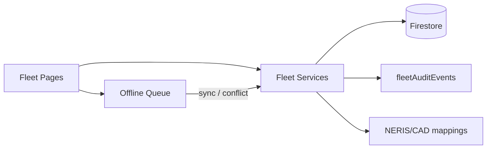

# Fleet Module — Architecture

```text
App.jsx (nav + permission gates)
  └─ Fleet* pages
       └─ FleetModuleLayout (shared chrome / a11y)
            └─ src/lib/fleet/* services (JSDoc business logic)
                 ├─ firestoreService (CRUD under departments/{id})
                 ├─ fleetAudit (fleetAuditEvents)
                 └─ offline queue (localStorage) → conflict resolve
```

## Patterns reused

- Tenant path: `departments/{departmentId}/…` (not `tenants/`)
- JSX + JSDoc (not TypeScript)
- Classic Apparatus coexists until cutover flags
- Feature modules as vertical slices (paths → defaults → service → page → rules → deploy)

## Safety controls

| Control | Location |
|---|---|
| Permission gates | `App.jsx`, `fleetPermissions.js`, `permissions.js` |
| Sensitive accident fields | `fleetRiskService` redaction |
| CAD cannot force in-service | `saveCadMapping` |
| Meter / completed check integrity | check version snapshots; no silent overwrite of completed checks |
| Offline conflicts | `fleetOfflineQueue.js` |

## Diagram (logical)


